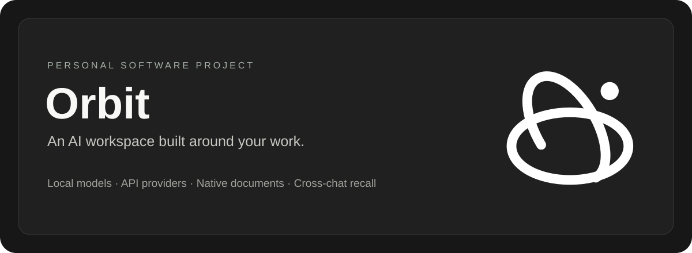
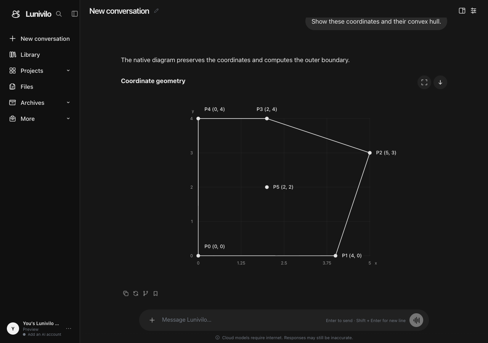

# Orbit — AI Workspace

Built by [Sathyanarayanan S](https://github.com/sathyanarayanans940-cyber).

Orbit is an AI workspace for LM Studio and Ollama, with optional cloud APIs, saved conversations, document generation and search across chats. I've been building it since September 2026.

**[Try Lunivilo, the hosted companion](https://lunivilo.pages.dev)** · **[View my profile](https://github.com/sathyanarayanans940-cyber)**

This page contains the project overview and screenshots. The application source and installers are private.

## Features

| Area | Capabilities |
| --- | --- |
| Conversations | Persistent chat history, file attachments, search and project organization |
| Models | Ollama and LM Studio locally; optional OpenAI, Anthropic Claude, DeepSeek and Gemini adapters |
| Usage controls | Choose allowed providers and models, track usage and limit input size to avoid higher pricing tiers |
| Documents | Structured PDF, Word, PowerPoint, Excel, notebook, text and ZIP generation with previews |
| Visuals | Native SVG charts and diagrams, Cartesian plots, hull computation and saved-geometry repair |
| Chat memory | Search earlier chats locally and retrieve excerpts from the original messages |
| Long chats | Summarize older context, retain problem/answer records and retrieve original passages when needed |
| Interface | Light/dark/custom themes, responsive phone layouts and PWA support |

## Engineering approach

The local app uses JavaScript, IndexedDB and Python gateways for model providers. Models return structured recipes for documents and SVG visuals; Orbit validates these before rendering them. Each provider adapter handles model capabilities, streaming and usage reporting.

Chat retrieval combines exact search with a small model that runs locally to find related text. Retrieved excerpts link to their original messages, and the index is updated when messages change or are deleted. Long-chat summaries retain problem/answer records and can be supplemented with original passages.

Lunivilo is the separately hosted companion, built on Cloudflare with Google sign-in and optional Google Drive synchronization. Users provide their own supported model-provider credentials. API usage is billed by the selected provider.

## Validation and current status

The 18 October 2026 validation recorded **998 passing Node tests** in an Orbit-only checkout, with two hosted-only checks skipped. Python contract tests recorded **147 passes** and 14 platform/environment-dependent skips. The shared workspace, which also includes hosted code, recorded 1,049 passing Node tests.

Coverage includes streaming, tool routing, context guards, memory retrieval, diagram geometry, document recovery, model selection and persistence. Browser checks are run separately for desktop and mobile layouts.

Orbit is still in active development. Generated content depends on the selected model and can contain errors.

## Screenshot

*Lunivilo displaying a coordinate diagram with fictional example data.*

Lunivilo requires Google sign-in and your own supported provider connection for model generation.

## Source access

For a technical source review, contact me through my [GitHub profile](https://github.com/sathyanarayanans940-cyber).

© 2026 Sathyanarayanan S. Third-party components retain their respective licenses.
